# AtmosphereMod

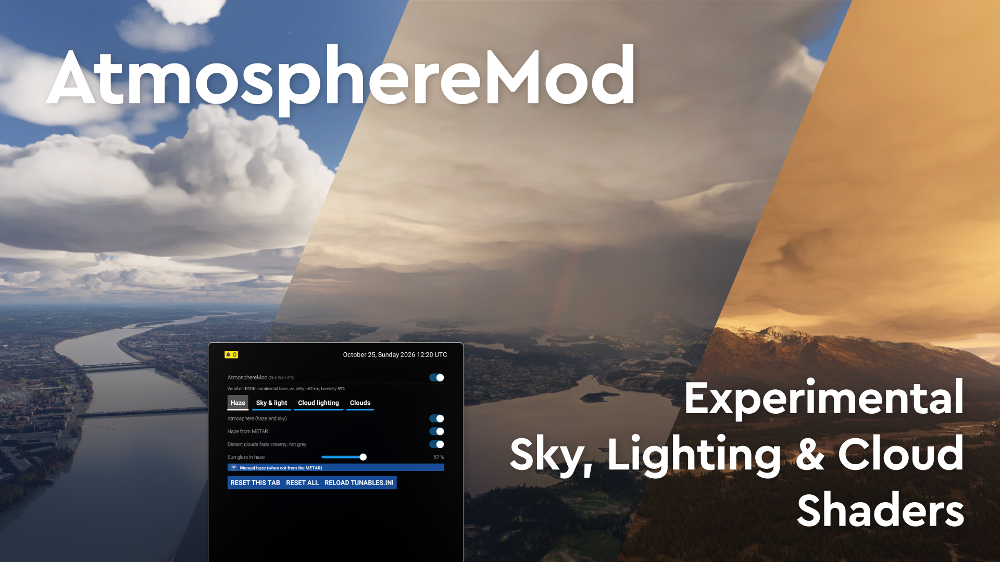

AtmosphereMod is an experimental ReShade add-on for **Microsoft Flight
Simulator 2024**. It aims to give the sim more realistic atmosphere and cloud
rendering, and consists of several components:

- **Haze.** MSFS 2024 does show atmospheric haze, to a certain extent. Visually
  it isn't convincing, and it is partly wrong in its calculation and its
  atmospheric behaviour:
  - it is the same haze on every flight, whatever the weather report says;
  - it is grey at every wavelength;
  - it thins out evenly with height, with no top, so there is no haze layer,
    no haze dome over the ground and no haze line on the horizon from cruise
    altitude.

  The mod replaces it with a layered haze, coloured by the kind of particles
  in it and set from the weather. It applies the same haze to the sky, the
  terrain and the clouds.
- **Sky colours.** A sim renders light in red, green and blue only, so it
  needs one value per colour for how strongly the air scatters sunlight and
  ozone absorbs it. MSFS takes them from ARPC, which averages the measured
  spectra over each colour. The mod's values are fitted so that the sim's sky
  matches the same sky computed across the whole spectrum. That is closest to
  real at low sun and dusk, when ozone keeps the sky overhead blue; the amount
  of ozone follows the season and latitude. A daylight white balance makes
  sunlight read as white.
- **Cloud lighting.** MSFS lights its volumetric clouds with a mild forward
  scattering and simple stand-ins for the light bounced inside them, which
  gives evenly lit, "cotton-ball" clouds. Silver linings are weak, and there
  is no glory and no shadow of your aircraft on the clouds. The mod changes
  how MSFS's own cloud renderer lights the clouds, to look more like real
  ones.
- **Cloud forming** (very experimental). This is just the beginning of
  experimenting with cloud shapes. MSFS's live-weather clouds are far thinner
  than real ones, puffy all over, and only loosely follow the real weather
  reports. The mod makes clouds more solid with flat bases, pulls the clouds
  near weather stations toward the layers their METARs report, and can grow
  thunderstorms where the reports show them.
- **METAR passing.** MSFS 2024 gives the METARs of its live weather only to
  JavaScript running inside the sim, not to add-ons like this one. A small
  EFB app, included with the mod, fetches them and passes them on. They drive
  the haze and the cloud forming.

> **Use at your own risk.** AtmosphereMod is an unofficial, experimental mod,
> provided as is, without any warranty. It has been developed and tested on a
> single PC. On other hardware or drivers it may not work, may show graphical
> errors, may crash the sim or may cost performance. See the
> [disclaimer](#disclaimer).

## Screenshots

Taken with live weather, each pair a few seconds apart with the mod off and
on, on two days. The settings were the shipping ones except:

- **9 November 2026**, with 0.7.0 (Cologne, Mumbai, Canberra, Stavanger and
  Vigo): solid clouds 2 (0.5 by default), crisper cloud edges 2 (off by
  default), Sun-facing cloud sides 40 % with Powder effect 0 %, haze strength
  105 % (75 % in Cologne and Mumbai), sun glare in haze 30 % (57 % by
  default), a 60 km station radius and small changes to the cloud lighting.
- **26 October 2026** (the thunderstorms on 29 October), the others: solid
  clouds 4 (2 by default then), crisper cloud edges 2 and small changes to the
  cloud lighting.

### Haze

<table>
  <tr>
    <th width="50%">Mod off (MSFS 2024)</th>
    <th width="50%">Mod on</th>
  </tr>
  <tr>
    <td>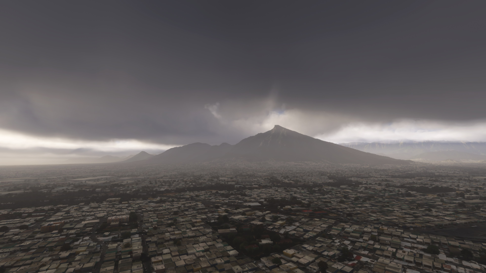</td>
    <td>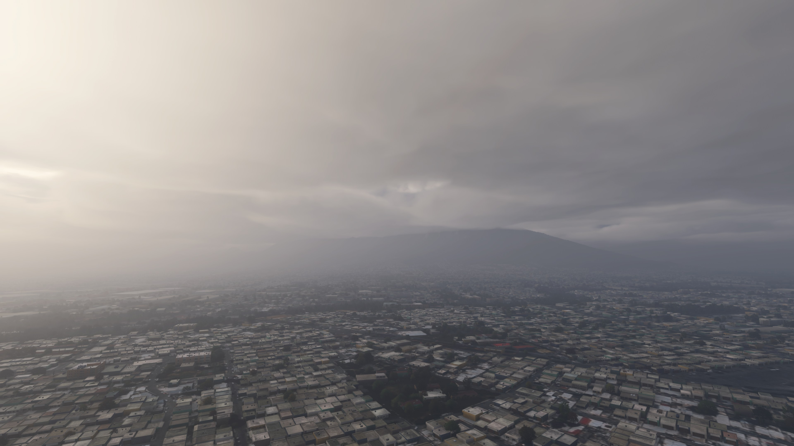</td>
  </tr>
  <tr>
    <td colspan="2"><b>Monterrey</b>, humid haze at 8 km: a bright, milky haze, with the mountains fading into it. MSFS shows clear air under a dark overcast. METAR <code>MMMY 261340Z 00000KT 5SM BKN020 BKN080 20/19 A3022 RMK 8/530 HZY</code></td>
  </tr>
  <tr>
    <td>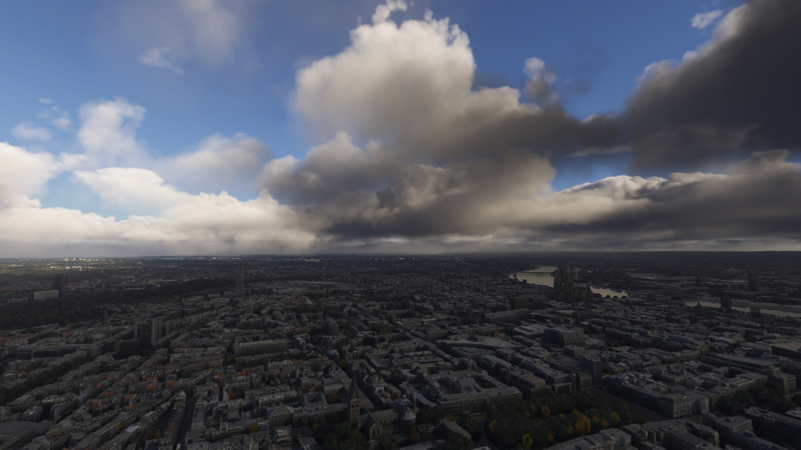</td>
    <td>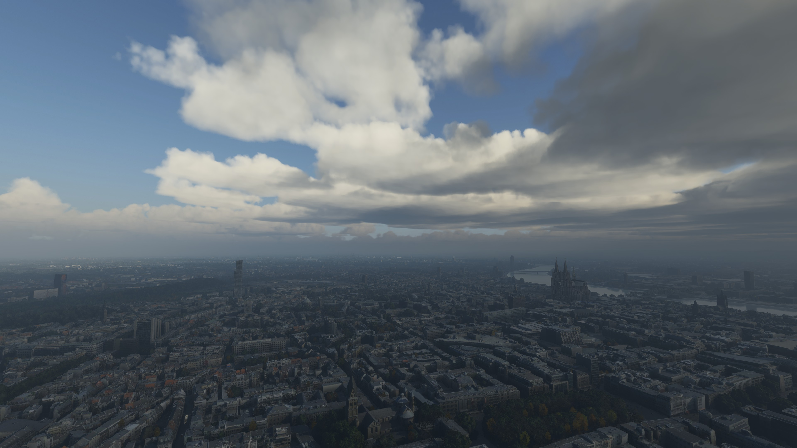</td>
  </tr>
  <tr>
    <td colspan="2"><b>Cologne</b>, humid air under an overcast, with 10 km or more reported: a light haze over the city and the Rhine, with the distance fading. MSFS's view is clear to the horizon. METAR <code>EDDK 090850Z AUTO 09004KT 050V140 9999 OVC033 07/05 Q1019 NOSIG</code></td>
  </tr>
  <tr>
    <td>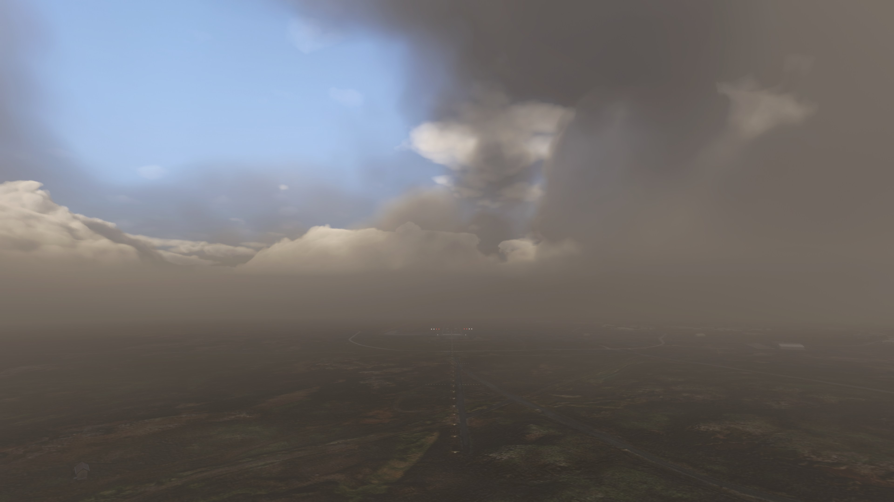</td>
    <td>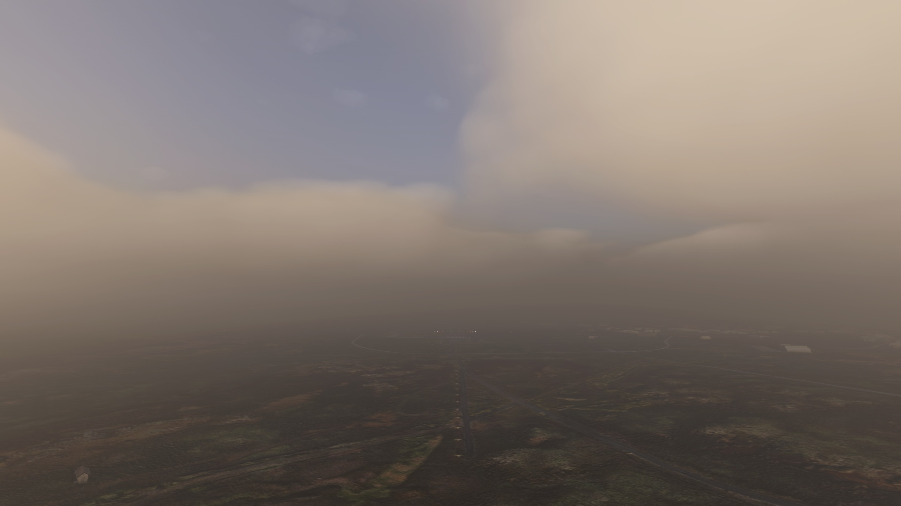</td>
  </tr>
  <tr>
    <td colspan="2"><b>Keflavík</b>, drizzle and mist at 2 km: the mist closes in as reported. MSFS shows blue sky and clouds beyond it. METAR <code>BIKF 261330Z 16003KT 2000 -DZ BR FEW002 BKN005 04/03 Q0983</code></td>
  </tr>
  <tr>
    <td>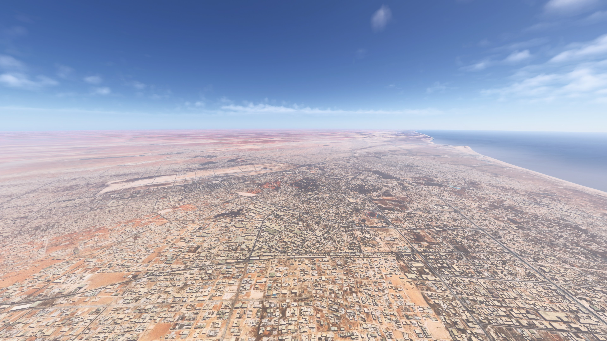</td>
    <td>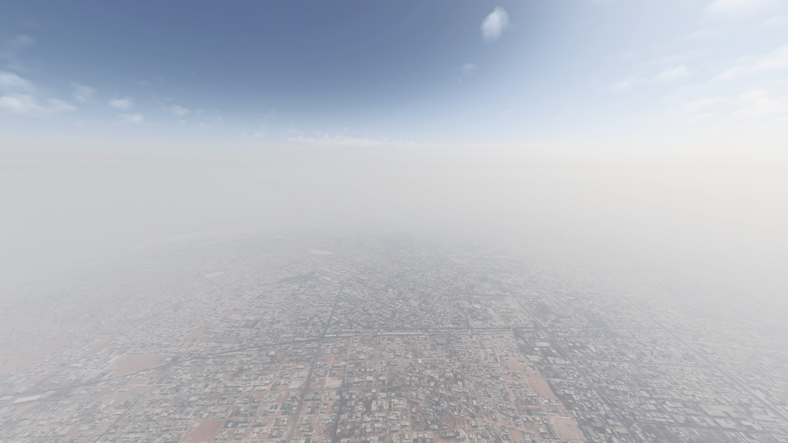</td>
  </tr>
  <tr>
    <td colspan="2"><b>Nouakchott</b>, 6 km in very dry air (the METAR has no weather code; the mod infers dust from the humidity): the haze closes in to the reported visibility. MSFS's view is clear to the horizon. METAR <code>GQNO 261400Z 12014KT 6000 NSC 41/07 Q1011 NOSIG</code></td>
  </tr>
  <tr>
    <td>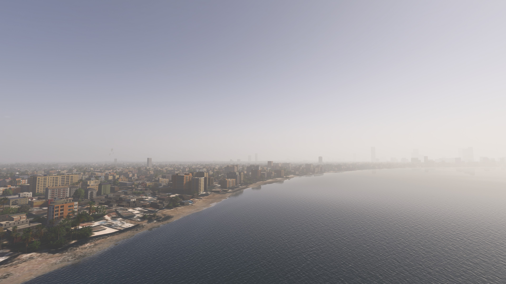</td>
    <td>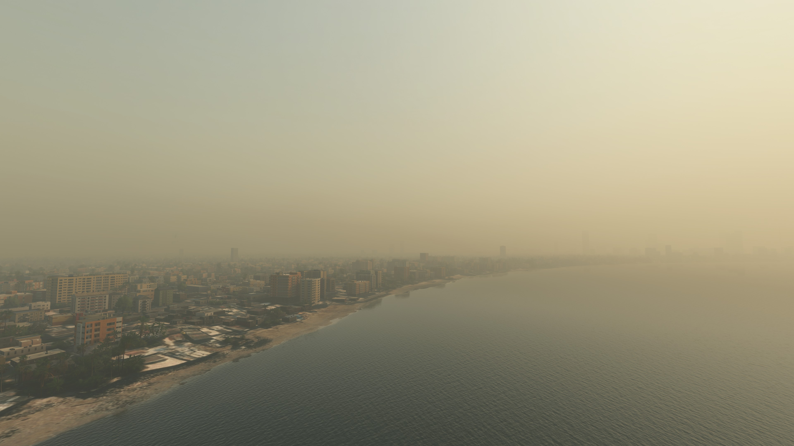</td>
  </tr>
  <tr>
    <td colspan="2"><b>Mumbai</b>, smoke at 4 km in dry air: the haze takes the colour of smoke and closes in to the reported visibility. MSFS's haze is a pale blue-white. METAR <code>VABB 090800Z 11012KT 4000 FU NSC 35/08 Q1013 NOSIG</code></td>
  </tr>
</table>

### Sky colours and low sun

<table>
  <tr>
    <th width="50%">Mod off (MSFS 2024)</th>
    <th width="50%">Mod on</th>
  </tr>
  <tr>
    <td>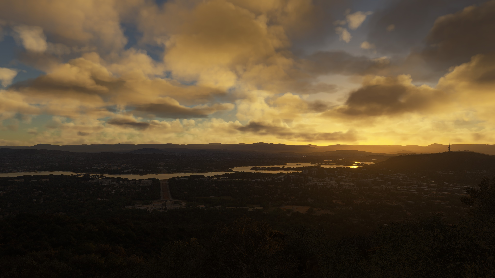</td>
    <td>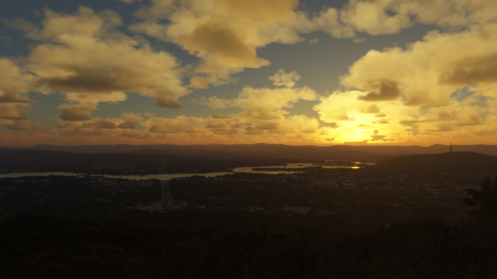</td>
  </tr>
  <tr>
    <td colspan="2"><b>Canberra</b> at sunset, the sun 2&deg; high: an orange band along the horizon, with the cumulus lit from below. MSFS's sunset is a paler yellow, with greyer clouds. METAR <code>YSCB 090800Z AUTO 29006KT 9999 // FEW079 17/04 Q1017</code></td>
  </tr>
  <tr>
    <td>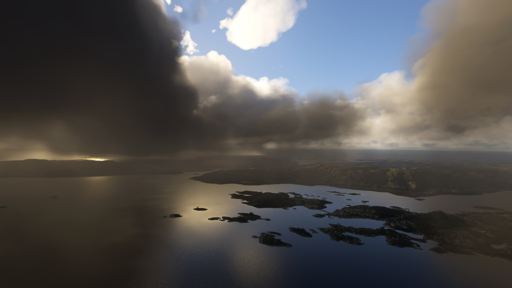</td>
    <td>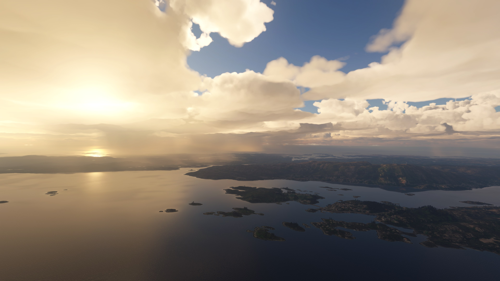</td>
  </tr>
  <tr>
    <td colspan="2"><b>Bergen</b> in the low afternoon sun: broken cloud with blue sky between, and the sun bright on the fjord. MSFS shows a dark shower cloud. METAR <code>ENBR 261350Z 24009KT 180V280 9999 VCSH BKN040CB 10/03 Q0998 TEMPO 24010G20KT RMK WIND 1200FT 28020G31KT</code></td>
  </tr>
</table>

### Cloud lighting

With the mod only: MSFS has neither a glory nor its strong silver lining.

<table>
  <tr>
    <td width="50%">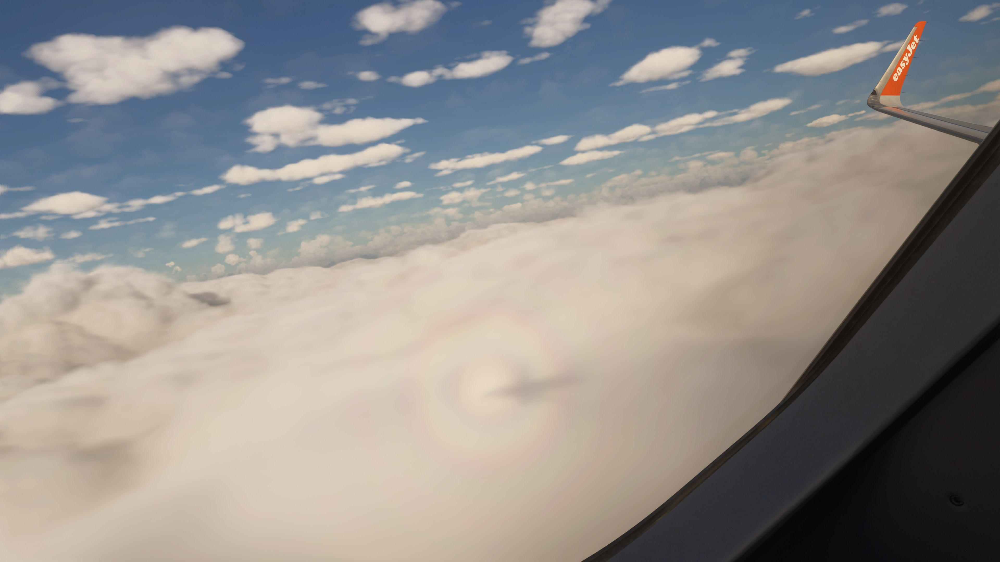</td>
    <td width="50%">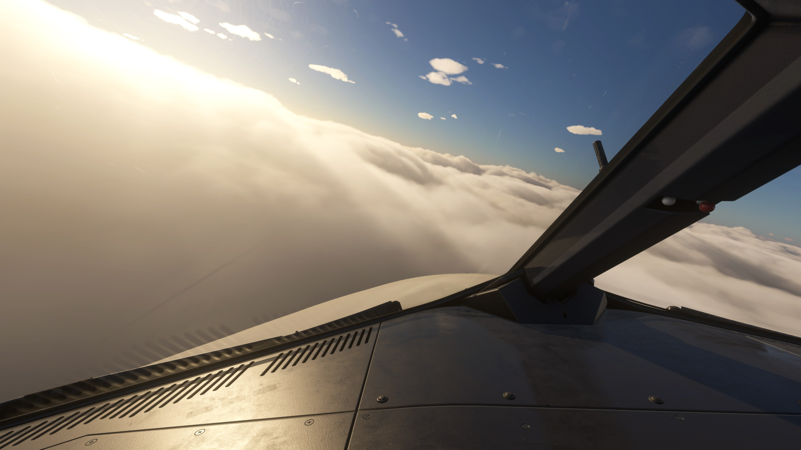</td>
  </tr>
  <tr>
    <td><b>The glory</b>, climbing out of London above the overcast: coloured rings around the aircraft's shadow on the cloud tops, seen from the cabin window.</td>
    <td><b>Toward the low sun</b>, over the same deck: the cloud tops glow with forward-scattered light, the sun 12&deg; high.</td>
  </tr>
  <tr>
    <td colspan="2">METAR <code>EGWU 261450Z 21010KT 6000 -DZ FEW005 OVC008 15/15 Q1006 TEMPO 9999 NSW</code></td>
  </tr>
</table>

### Clouds

<table>
  <tr>
    <th width="50%">Mod off (MSFS 2024)</th>
    <th width="50%">Mod on</th>
  </tr>
  <tr>
    <td>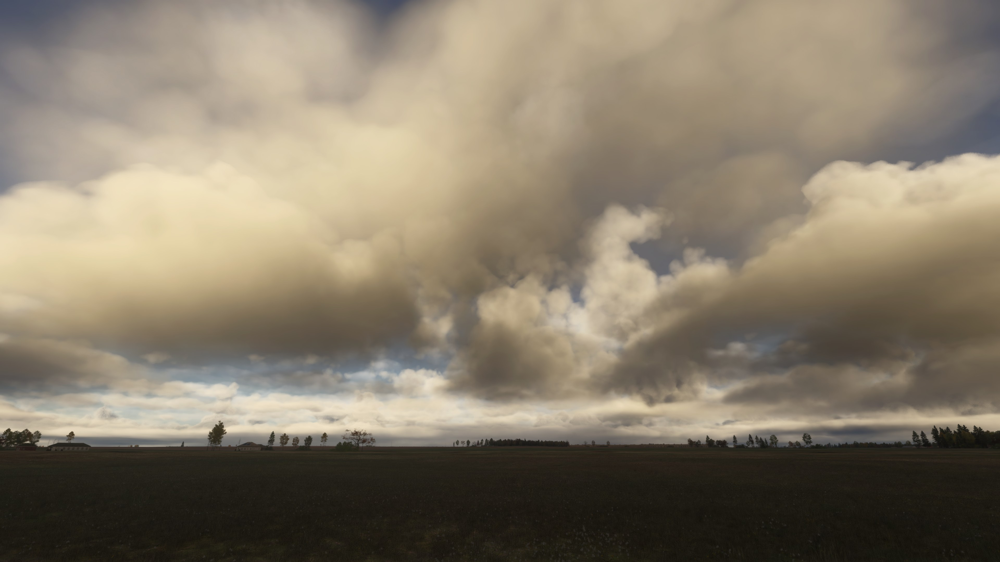</td>
    <td>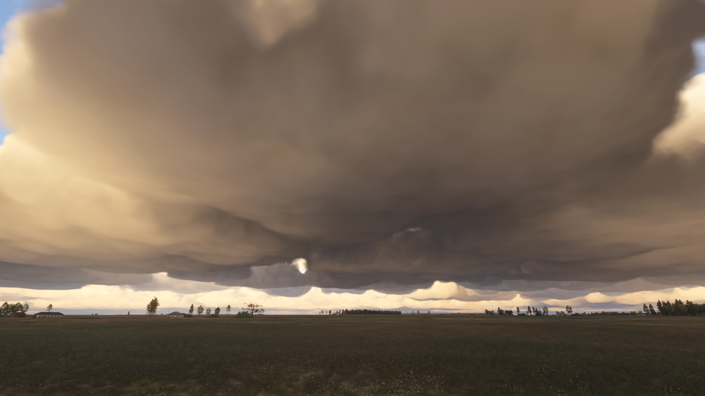</td>
  </tr>
  <tr>
    <td colspan="2"><b>Palanga</b>: the broken layers and the CB the METAR reports, a dark deck with light under its edge. MSFS shows scattered cumulus. METAR <code>EYPA 261320Z 23008KT 170V280 9999 SCT019 BKN023 BKN029CB 12/08 Q1011</code></td>
  </tr>
  <tr>
    <td>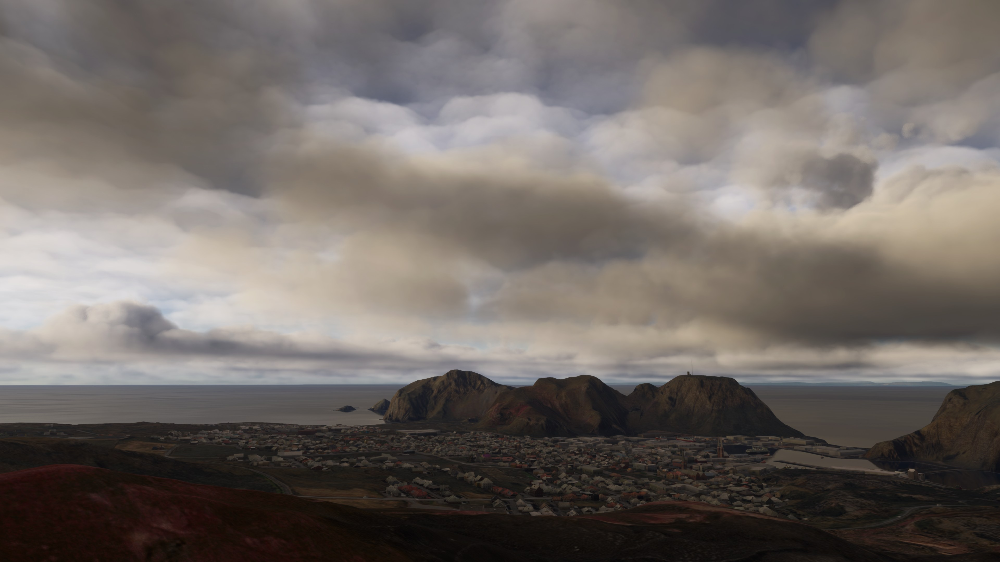</td>
    <td>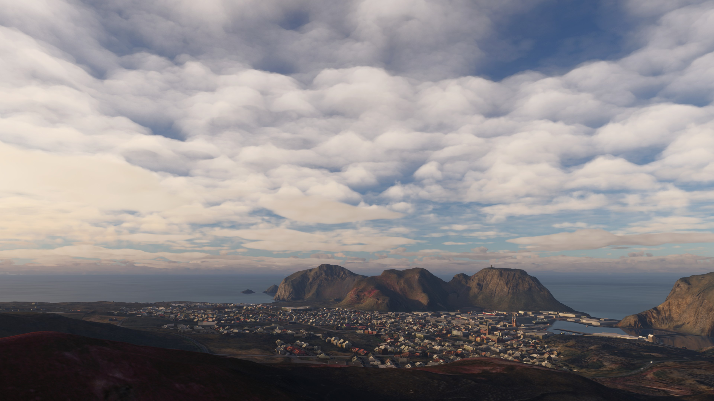</td>
  </tr>
  <tr>
    <td colspan="2"><b>Westman Islands</b>: a field of altocumulus with blue gaps, as reported at 16,000 ft. MSFS draws heavy grey layers. METAR <code>BIVM 261400Z 36005KT 9999 FEW014 BKN160 03/00 Q0982</code></td>
  </tr>
  <tr>
    <td>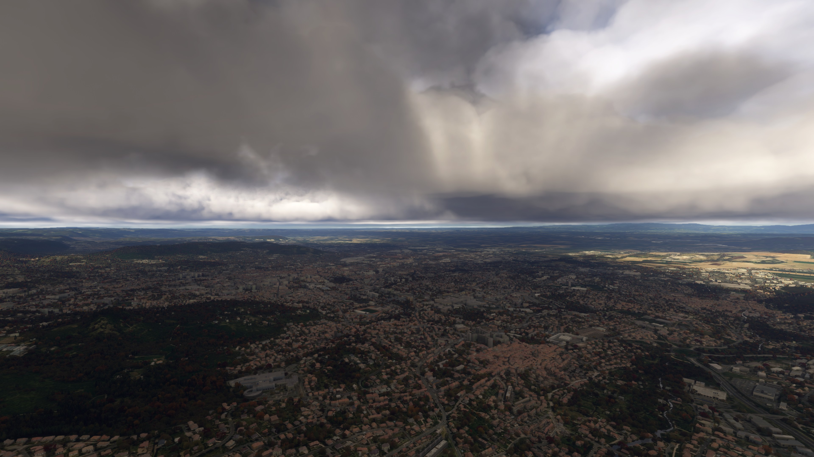</td>
    <td>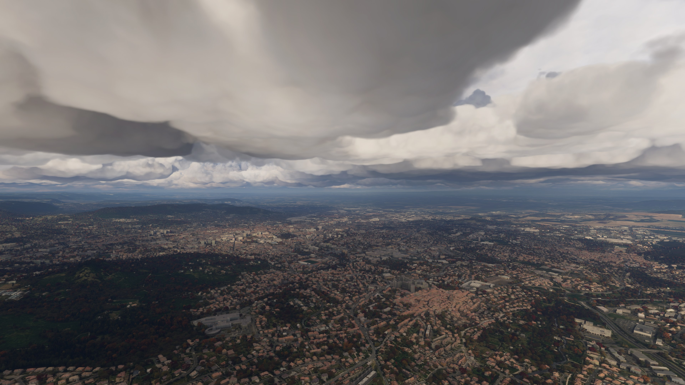</td>
  </tr>
  <tr>
    <td colspan="2"><b>Clermont-Ferrand</b>, layered stratocumulus: smooth, flat bases with soft edges. MSFS's clouds are streaky grey. METAR <code>LFLC 261400Z AUTO 15003KT 090V230 9999 SCT029 BKN041 BKN047 16/09 Q1020 NOSIG</code></td>
  </tr>
  <tr>
    <td>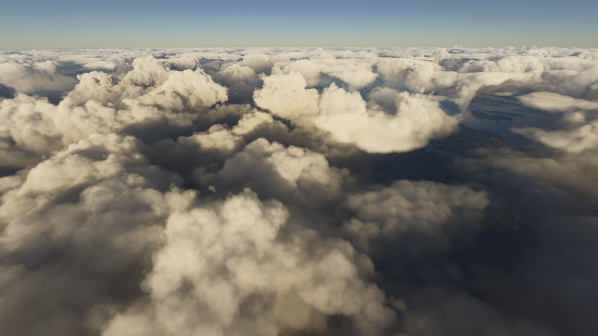</td>
    <td>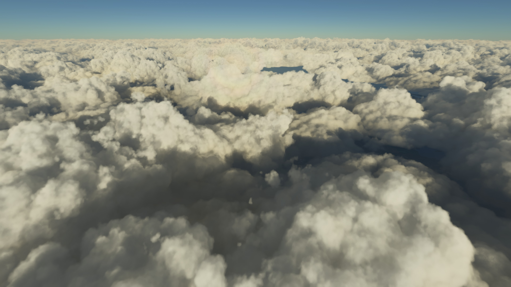</td>
  </tr>
  <tr>
    <td colspan="2"><b>Above Stavanger</b>, on the deck the METAR reports, the sun 7&deg; high: firm, sunlit tops at varied heights. MSFS's tops are grey and see-through. METAR <code>ENZV 090820Z 08003KT 9999 -RA OVC040 07/04 Q1020 NOSIG</code></td>
  </tr>
  <tr>
    <td>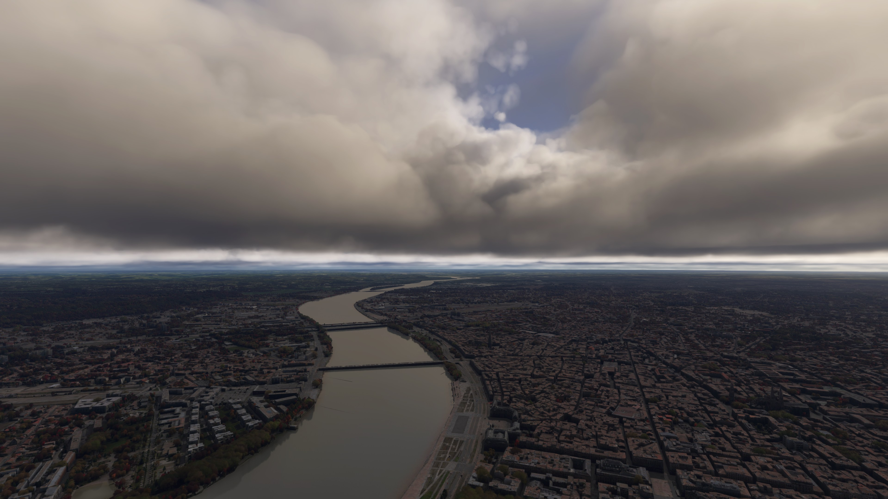</td>
    <td>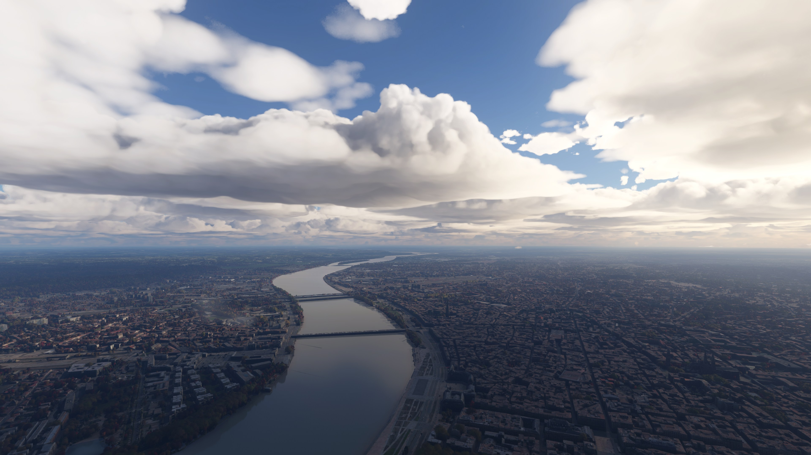</td>
  </tr>
  <tr>
    <td colspan="2"><b>Bordeaux</b>: broken cumulus with blue sky between, as reported. MSFS closes it to a dark overcast. METAR <code>LFBD 261400Z AUTO VRB03KT 9999 BKN028 20/15 Q1019 NOSIG</code></td>
  </tr>
  <tr>
    <td>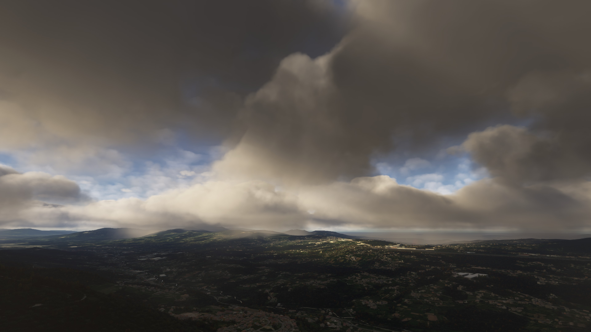</td>
    <td>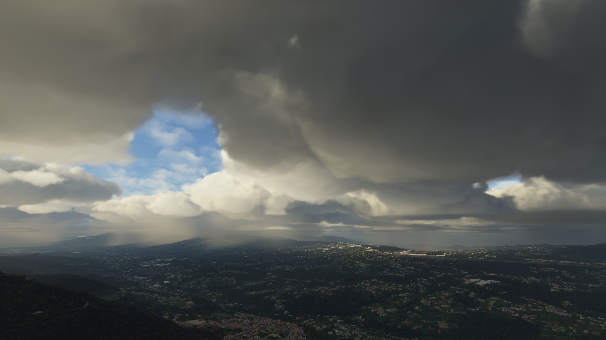</td>
  </tr>
  <tr>
    <td colspan="2"><b>Vigo</b>: the broken layers the METAR reports, dark with blue sky between and a shower over the hills. MSFS's clouds are soft and brownish. METAR <code>LEVX 090830Z 19010KT 150V220 9999 FEW011 SCT025 BKN032 16/14 Q1004 NOSIG</code></td>
  </tr>
</table>

### Fly-through clouds

With the mod only: in MSFS's own cloud the wing stays almost clear. Taken on 3
November 2026 with visibility inside clouds 40 m and structure 50 % (the
shipping values are now 10 m and 10 %), solid clouds 0.5.

<table>
  <tr>
    <td>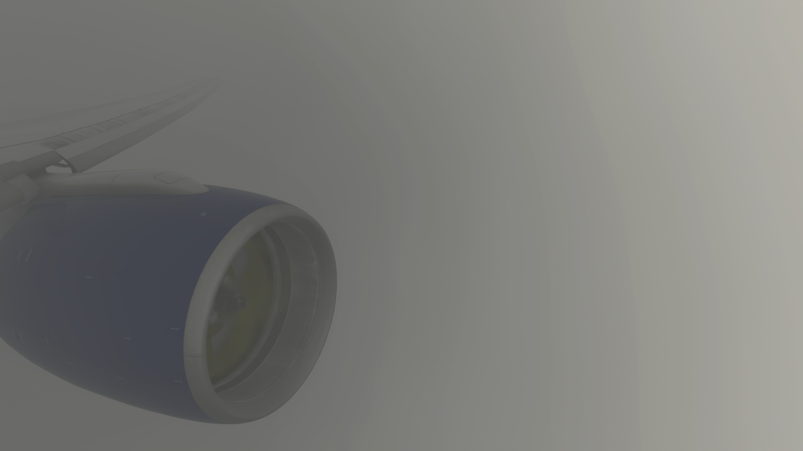</td>
  </tr>
  <tr>
    <td><b>In the overcast</b> near Minneapolis, from the cabin window: the engine and the wing fade into the cloud a few metres out, in the cloud's own grey light. METAR <code>KMSP 031853Z 01009G21KT 5SM -RA BR OVC010 14/13 A2966 RMK AO2 RAB06 SLP043 P0001 T01390128</code></td>
  </tr>
</table>

### Thunderstorms

Near Manaus in the late afternoon, with thunderstorms switched on (`C32`,
experimental, off by default). The other settings were those of 26 October
above, except solid clouds 0.5 and a 60 km anchoring radius.

<table>
  <tr>
    <th width="50%">Mod off (MSFS 2024)</th>
    <th width="50%">Mod on</th>
  </tr>
  <tr>
    <td>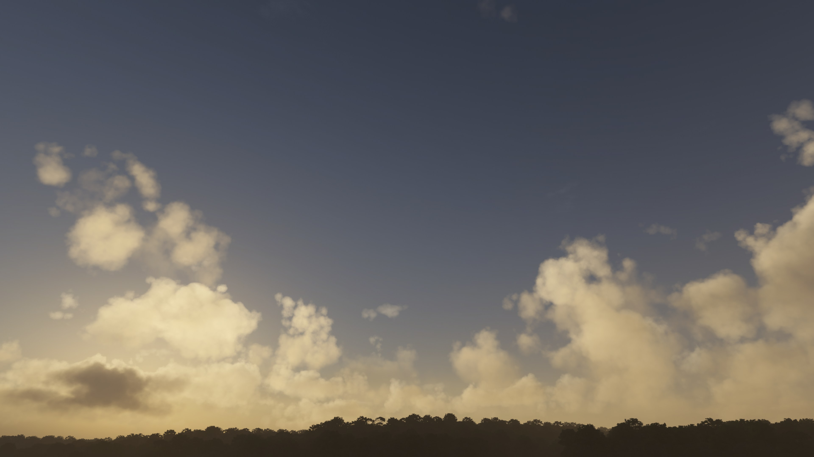</td>
    <td>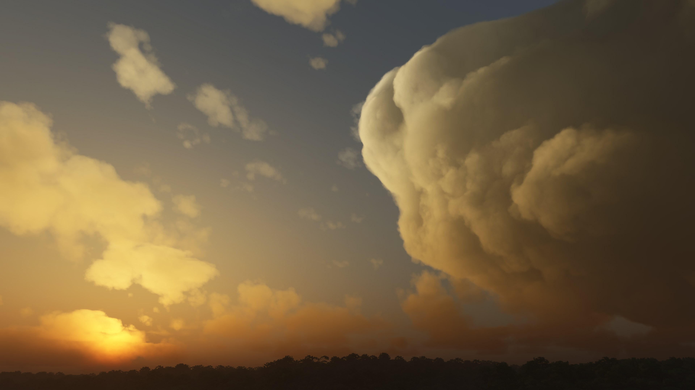</td>
  </tr>
  <tr>
    <td colspan="2"><b>Toward the low sun</b>: a towering cumulus where the METAR reports TCU, lit orange by the sun 5&deg; high in the haze. MSFS shows fair-weather cumulus.</td>
  </tr>
  <tr>
    <td>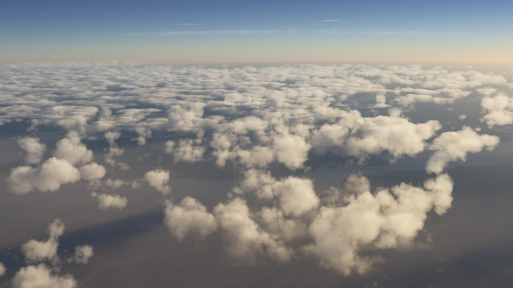</td>
    <td>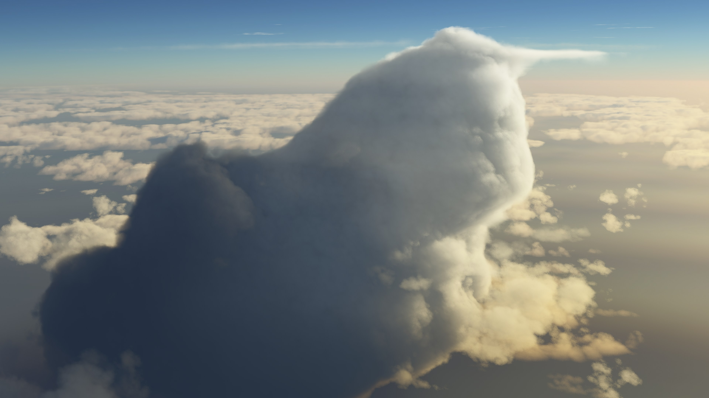</td>
  </tr>
  <tr>
    <td colspan="2"><b>Above the cumulus</b>: the tower rises out of the few cumulus the METAR reports, lit from the side by the low sun. MSFS shows a denser field of small cumulus and no tower.</td>
  </tr>
  <tr>
    <td colspan="2">METAR <code>SBEG 292100Z 14005KT 9000 VCSH FEW030 FEW035TCU 32/24 Q1008</code></td>
  </tr>
</table>

### Settings on the EFB tablet

The AtmosphereMod app's four tabs (see [Settings](#settings)), here with a few
settings changed from the defaults.

<table>
  <tr>
    <td width="50%"><a href="Screenshots/efb-haze.png">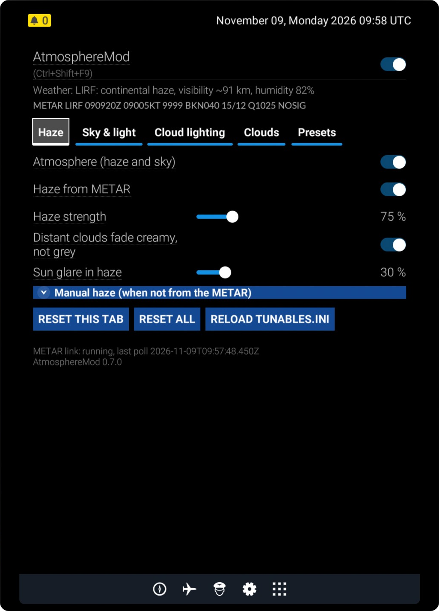</a></td>
    <td width="50%"><a href="Screenshots/efb-sky-light.png">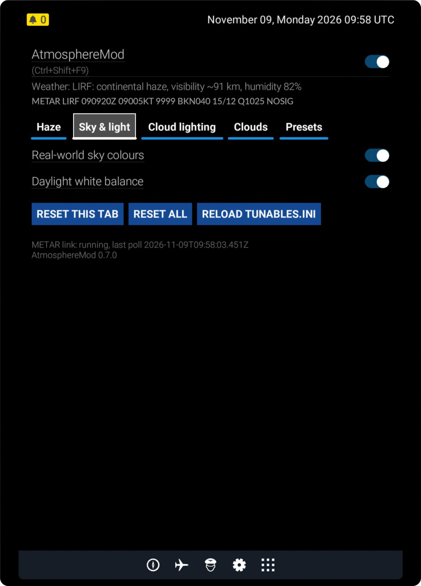</a></td>
  </tr>
  <tr>
    <td><b>Haze</b>: the atmosphere and the METAR's haze; the manual haze is folded away.</td>
    <td><b>Sky &amp; light</b>: real-world sky colours and the daylight white balance.</td>
  </tr>
  <tr>
    <td><a href="Screenshots/efb-cloud-lighting.png">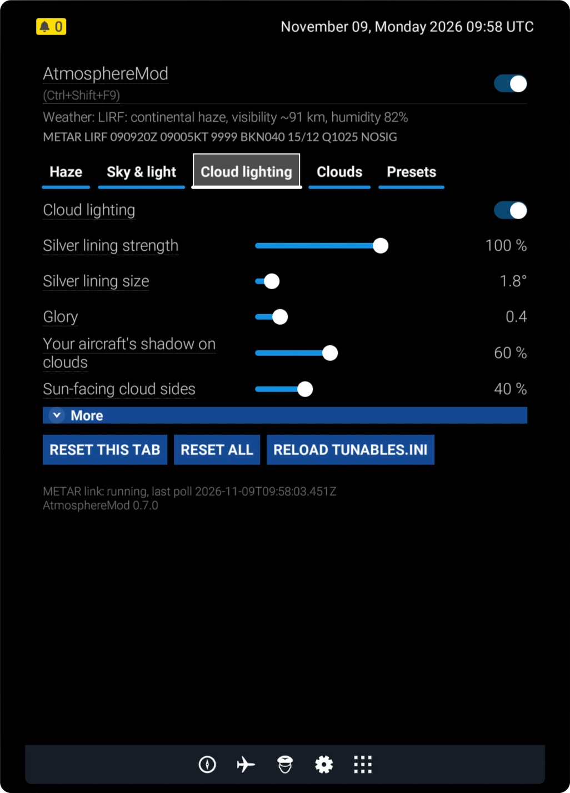</a></td>
    <td><a href="Screenshots/efb-clouds.png">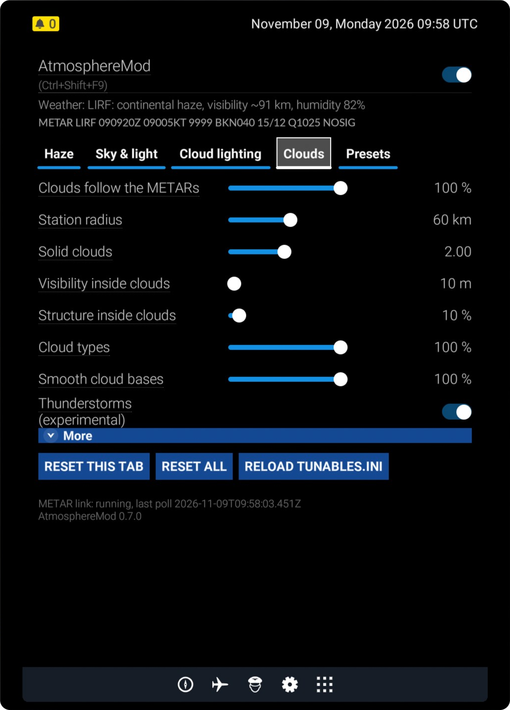</a></td>
  </tr>
  <tr>
    <td><b>Cloud lighting</b>, with its "More" section open: silver lining, glory, your aircraft's shadow.</td>
    <td><b>Clouds</b>, with "More" open: the METAR anchoring, solid clouds, cloud types and smooth bases; under "More", each cloud type's thickness.</td>
  </tr>
</table>

## What it does

Ctrl+Shift+F9 switches between the mod and stock at any time, for comparison.
The settings named below are in `tunables.ini` ([Settings](#settings)).

### Haze

What it can do:
- **A haze layer with a top.**
  - Most of the haze sits in the boundary layer, the lowest one or two
    kilometres. Its top has an adjustable height and sharpness (`T1`–`T3`).
  - From cruise altitude you see the haze dome over the ground and a sharp
    haze line on the horizon, with clear air above.
  - A thin haze in the free troposphere above it thins out with height
    (`T4`, `T5`).
- **Haze by particle type.**
  - Its colour: fine continental haze is slightly bluish, humid or maritime
    haze white, smoke and dust brownish (`T10`, with absorbing brown haze
    `T6`).
  - Its glare: the forward-scattering glow toward the sun (`T9`), plus a weak
    glow away from it (`T7`).
- **Haze from the weather** (`T13 = 1`). Each METAR station's report sets
  the haze around it:
  - the visibility;
  - the humidity, from the temperature and dew point;
  - weather codes such as mist (BR), haze (HZ), smoke (FU) and dust (DU).

  Together they set the amount of haze, the layer's top (above the station's
  elevation) and its type.
- **Haze from all the stations around** (`T15 = 1`, experimental). The mod
  keeps up to eight stations around the aircraft: the nearest, the ones
  ahead, beside and behind it, and the ones it has passed. Every part of the
  view gets the haze of the stations nearest to it, weighted by distance:
  - A hazy valley ahead looks hazier than the clear coast behind you.
  - Flying from one station's area to the next, the haze changes gradually.
    The whole view no longer switches at once when the nearest station
    changes.
  - A station's new report fades in over five minutes.
  - Stations whose METAR gives no visibility don't count for the haze, and a
    report hours older than the others (a station that stopped reporting) is
    ignored.
  - "10 km or more" (9999, CAVOK) next to a station reporting less is taken
    as just over 10 km. Far from such stations it's estimated from the air
    mass and humidity.

  With `T15 = 0`, the nearest METAR alone sets the haze everywhere, smoothed
  over about 30 seconds.
- **Haze strength** (`T16`). A slider under "Haze from METAR" in the app, for
  when the reported haze looks too strong or too weak to you:
  - 100 % is what the reports say. 50 % makes the haze half as thick, so the
    visibility about doubles; 200 % makes it twice as thick.
  - It changes the amount of haze, not the layer's height or its colour.
  - It doesn't change the sim's own fog and mist.
- **The same haze everywhere.** It applies to:
  - the sky;
  - the terrain and buildings;
  - the clouds, where distant ones turn creamy as blue light is scattered
    out (`T11`);
  - reflections, and the sky light the clouds are lit with.

  At high altitude it also reaches distant low clouds beyond the sim's own
  range of about 357 km (`T12`).

What it can't do:
- **Fog and mist layers.** The sim draws low fog and mist as a separate
  system, which the mod leaves alone. In fog or very low visibility, most of
  what you see is still MSFS's own fog.
- **Detail between stations.** The haze changes only as much as the
  stations' reports do. It can't show a smog plume over one city that no
  station reports, or haze that stays in one valley.
- **The sun's light through the haze** is still worked out from the haze at
  the aircraft, wherever it shines. So is the haze colour of distant clouds.
- **Without METARs.** If the EFB app isn't installed, or the sim gives no
  METARs, the fixed values `T1`–`T6` are used.

### Sky colours

What it can do:
- **Sky colours fitted to the full spectrum** (`T8 = 1`):
  - The sim's sky model works in red, green and blue. It needs one value
    per colour for how strongly the air scatters sunlight (Rayleigh) and how
    strongly ozone absorbs it.
  - MSFS uses ARPC's values (`T8 = 0`), which average the measured spectra
    over each colour.
  - The mod's values are fitted so that the sim's model in three colours
    matches the same model computed at 95 wavelengths. That model uses the
    measured sunlight, air and 300 Dobson units of ozone, and is checked in
    clean and hazy air.
  - The difference shows at low sun and dusk. Ozone keeps the sky overhead
    blue as the sun sets, and a low sun is the right shade of orange.
  - Versions up to 0.3.0 used the textbook values of Bruneton and Hillaire
    here. Those turned dusk pink-purple and a low sun too orange.
- **Ozone by season and place** (`T14`):
  - The amount of ozone sets how blue the sky stays at dusk. It ranges from
    about 260 Dobson units in the tropics to about 440 in Arctic spring.
  - The mod takes it from a climatology of balloon and satellite
    measurements (Fortuin & Kelder, 1998, published by KNMI's TEMIS), at
    your aircraft's latitude and the sim's date.
  - `T14` can fix it instead (300 is the global average). It needs no
    internet connection and applies with `T8 = 1`.
- **A daylight white balance** (`C22`):
  - Sunlight is slightly warm on its own. MSFS uses its real colour, from
    the measured solar spectrum. Eyes and cameras adapt to that, but the sim
    shows it against a fixed white, so sunlit clouds look cream.
  - The white balance makes sunlight read as white, as you'd see it.
  - It shifts the sky, the clouds and the sunlit terrain alike.

What it can't do:
- The brightness and colour of the sun and moon themselves, the stars and the
  night-time light pollution stay the sim's.
- It doesn't change the sim's exposure or the image's overall colour grading.
- The ozone is a monthly average for your latitude. Day-to-day changes in
  the real amount, typically 10–15 %, aren't included.

### Cloud lighting

What it can do, inside MSFS's own cloud renderer:
- **Silver linings.** A sharper forward-scattering lobe (`C1`, `C2`) brightens
  cloud edges toward the sun. Inside a cloud, the sun becomes a bright glow.
- **Light bounced inside the clouds.** Cloud sides and interiors are brighter,
  as in real clouds lit by light scattered many times (`C3`–`C5`).
- **The "powder" effect.** With the sun behind you, thin edges look grey and
  dense cores white, which outlines each cloud turret (`C6`, `C7`).
- **A glory.** Coloured rings appear around your shadow on sunlit cloud tops,
  sized by the droplet size (`C9`–`C11`).
- **Your aircraft's shadow on the clouds** (`C12`):
  - with Raytraced Shadows off, it is taken from the sun's shadow map;
  - with them on, it is traced from the sim's ray-tracing scene;
  - its edges soften with distance, as the sun's disc blurs them.
- **Crisper cloud edges** (`C8`, off by default).
- **Sun-facing cloud sides** (`C36`, off by default). Light on the sides of
  clouds that face the sun, worked out as real, thick cloud reflects it:
  - it fades out where another cloud shades the spot;
  - it takes the colour of the sim's sunlight, so it turns warm with a low
    sun;
  - it goes best with the powder effect (`C6`) at 0.

What it can't do:
- The clouds' shapes, their resolution and the way MSFS steps through them
  stay the sim's. The mod changes how they are lit.
- Rain shafts, rainbows, lightning and the light of cities on cloud bases at
  night are the sim's.

### Cloud forming (very experimental)

What it can do:
- **Solid clouds** (`C16`, `C17`):
  - MSFS's clouds are far thinner than real ones, so their bases and edges
    are see-through and the sun glows through an overcast.
  - The mod makes low clouds and cumulus solid from the base up, without
    making them darker.
- **Fly-through clouds** (`C33`, `C34`):
  - MSFS's clouds are so thin inside that you can see for hundreds of metres
    in them, and the wings never fade into the cloud. In real clouds you see
    about 20–150 m.
  - Around your aircraft, the mod gives liquid clouds a real cloud's density:
    the wingtips fade into the cloud, and in a dense one they disappear. It
    takes the cloud's own light, so the fog is white in a bright cloud and
    grey in a dark one.
  - It applies within about 100 m of the camera and fades out by 300 m, so
    clouds seen from farther away keep their look, whatever `C16`. Ice
    clouds (cirrus) stay thin, as real ones are.
  - It starts 25 m inside the cloud and is full from 75 m in. A cloud's outer
    layer stays as MSFS draws it and veils the fog behind it, so skimming a
    cloud top or passing a cloud's edge doesn't break the fog into bands and
    blocks (MSFS draws its clouds at a reduced resolution, and in steps of
    20 m near the aircraft).
  - `C33` is the visibility inside a dense cloud, in metres (10 by default;
    thinner parts of a cloud allow more); 0 turns it off.
  - **Turn off other in-cloud effects:** add-ons that simulate flying
    through clouds, such as TriTriSim GFX's wing fade effect or CloudSurf
    (flightsim.to), will most likely conflict with the mod's denser clouds.
    Turn them off; to keep theirs instead, `C33` at 0 turns Fly-through
    clouds off.
  - **Structure** (`C34`): the sim's clouds are almost even inside, so the
    fog has patches of denser and thinner cloud, fixed to the ground, that
    come at you and pass by as you fly. Each patch is shaded by the cloud
    toward the sun, so thinner parts are brighter and denser ones darker,
    which is what makes them show. 0 gives an even fog; 0.1 by default.
- **Cloud types** (`C23`–`C27`, live weather). Real clouds aren't all equally
  solid: cumulus are dense with crisp edges, while stratiform clouds hold less
  water, spread more evenly, and have softer edges.
  - MSFS's weather has no cloud types, so the mod infers them from each
    layer's height, depth and cover. Thin broken or overcast decks become
    stratocumulus, stratus, altocumulus or altostratus. A few scattered
    clouds below about 500–750 m above the ground are stratus fractus, the
    ragged scraps of a low deck, and are drawn like stratus. Other scattered
    low clouds and deep clouds stay cumulus, and cirrus keeps its own look.
  - Each stratiform type gets its own share of the solid-cloud thickness
    (`C24`–`C27`: 60, 50, 40 and 30 % by default) and the sim's soft edges.
    Stratus and stratocumulus decks stay grey and solid from below, as real
    ones are. Altocumulus, and altostratus even more, also get a softer base,
    so a thin altostratus is a veil the sun can shine through. Cumulus keeps
    the full thickness and gets crisp edges.
  - Each type has its own shape. Altocumulus breaks up into smaller, finer
    cloudlets, and stratocumulus into rows. The sim's own stratiform layers
    become flat-topped decks, as the METAR-described ones do; stratus and
    altostratus also get smoother. Deck tops are lumpy rather than cut off at
    one altitude.
  - `C23 = 0` draws every cloud like cumulus again.
- **Translucent high clouds** (`C18`, `C19`). Cirrus and thin mid-level
  sheets keep a translucent, soft look; `C19` makes cirrus more visible.
- **Flat cloud bases** (`C28`–`C31`):
  - MSFS roughens every cloud surface with the same round puffs, 100 to 250 m
    across, which look like popcorn under solid cloud bases.
  - The mod fades them out toward each cloud's base, so bases are flat and
    tops keep their billows.
  - Optionally it adds finer billows on the tops (`C30`, off by default). They
    switch off the rising air of varied cloud tops (below).
- **Varied cloud tops** (`C37`, on by default, `tunables.ini` only):
  - MSFS's weather gives a whole region one cloud layer, and every cloud in it
    ends at the same height, so the layer looks cut off flat, like a slice of
    cake.
  - Real air doesn't rise the same everywhere. The mod gives each place its
    own lift: where the air rises more, clouds grow taller, by up to about
    2.5 km, and tops round off instead of ending in a flat cut.
  - Flat decks, and the clouds above them, keep their flat tops.
  - It shapes the clouds where the sim builds them, so their shadows match.
  - `C37 = 1` keeps only the rounded tops, and `C37 = 0` gives the sim's own.
- **METAR anchoring** (`C20`, `C21`, live weather). Near weather stations, the
  sim's clouds are pulled toward the layers the METARs report:
  - **What follows the report:** the cover (FEW, SCT, BKN, OVC), the base
    height, and a cloud type:
    - stratus and stratocumulus decks;
    - cumulus;
    - altocumulus and altostratus;
    - cirrus;
    - CB and TCU, as a base layer with isolated towers.
  - **Several stations at once:** up to 8 stations are blended by distance,
    and stations ahead of you are looked up before you get there.
  - **Gradual changes:** a new station fades in over 3 minutes, and a new
    report crossfades over 5 minutes.
- **Thunderstorms** (`C32`, live weather, experimental, off by default). MSFS's
  live weather has no thunderstorm clouds: its heaviest rain falls from the
  same flat-topped deck as the drier cloud around it. With this on, the mod
  grows cumulonimbus where something shows a storm:
  - **Where:** only near a METAR station that reports thunder (TS, VCTS) or a
    CB or TCU layer, or under very heavy rain in the sim's weather (40 mm/h
    and more, smaller storms). Elsewhere there are none.
  - **What:** towers from the cloud base up toward the tropopause, leaning
    with the wind, with an overshooting top, flanking turrets, a wall cloud and
    an anvil of thin ice spreading downwind, frayed by the sim's own cirrus.
  - **Five types:** single cells, sheared storms, multicells, supercells and
    storms embedded in a cloud deck, chosen by the wind, how strongly the
    reports show a storm, and the cell's size. Supercells need reported
    thunder, strong wind and a big cell, so they are rare.
  - **A life cycle:** each storm lives 45–80 minutes. It grows from towering
    cumulus, matures and dissipates, and the next one forms elsewhere. Most
    are small; the biggest are the rarest.
  - **Lit like real towers:** MSFS darkens a cloud by everything above it, which
    would leave a tall tower grey at any sun angle. The mod gives the towers'
    sides the sky light they would get in the open.

What it can't do:
- **Cloud type and depth aren't reported.** A METAR gives only each layer's
  cover and base. Type and depth are inferred from the height, the cover, the
  temperature and dew point and the time of day. So the clouds near a station
  match its report, not necessarily the real sky.
- **Only what a METAR can see.** Above about 12,000 ft over the station (5,000
  ft with CAVOK or NSC, or the top of an overcast), the sim's own clouds stay.
  Far from any station, the sim's own weather shows.
- **Less rain near stations.** MSFS makes its rain, and the weather radar's
  picture, from the clouds it has. Where the anchoring gives thinner cloud
  than the sim had, the rain and the radar thin out with it, even when the
  report has rain or a thunderstorm. With "Clouds follow the METARs" at 0 in
  the app's Clouds tab (`C20 = 0`), the sim's rain is back.
- **Live weather only.** Weather presets and third-party weather engines (such
  as Active Sky) keep their own cloud layers.
- **Experimental.** Shapes and transitions can look wrong in some weather.
  `C20 = 0` switches the anchoring off.
- **Thunderstorms are visual only.** The aircraft doesn't feel them (no
  turbulence, updrafts or downdrafts), there is no lightning of their own, and
  the weather radar doesn't show them. Over oceans and remote areas
  without stations they form only under very heavy rain.

### METAR passing

**Why it's needed.** MSFS 2024 makes the METARs of its live weather available
only to JavaScript running inside the sim, through the SDK's facility loader.
SimConnect's weather observation functions return errors in MSFS 2024, so an
add-on outside the sim can't read them directly.

**What the EFB app does.**
- The app is called "AtmosphereMod" and is installed into your Community
  folder.
- It runs in the background on every aircraft's tablet (EFB) from the start
  of the flight. You don't need to open it for the METARs; opening it shows the
  mod's settings (see [Settings](#settings)), its status and the last METAR it
  passed on.
- When the add-on asks, it fetches a METAR from the sim and sends it to the
  add-on over the sim's CommBus, through SimConnect.

**Which METARs.**
- Every minute: the METAR nearest the aircraft, for the haze and the clouds.
- Every 15 seconds, in turn: one more, nearest a point around the aircraft
  (50 and 110 km ahead, 60 km to either side, 80 km behind to either side and
  70 km behind). The cloud anchoring then knows the stations ahead, and the
  haze has stations all around.
- For each new station, the add-on asks SimConnect for the station's position
  and elevation.

These are the sim's own METARs, describing the same weather MSFS renders. No
outside weather service or Active Sky is involved. Everything the add-on does
with them is logged in `%LOCALAPPDATA%\AtmosphereMod\logs\weather.log`.

**What it can't do.**
- Without the EFB app, the haze uses fixed values and the cloud anchoring
  stays off.
- Where stations are far apart (over oceans, in remote areas), the anchoring
  is coarse.

## Requirements

- Microsoft Flight Simulator 2024 on PC (MS Store / Xbox app or Steam),
  running DirectX 12.
- [ReShade](https://reshade.me) **6.8 or newer, the build "with full add-on
  support"**, installed for `FlightSimulator2024.exe`. The standard ReShade
  build only loads approved add-ons.
- Windows 10 or 11 and a DirectX 12 graphics card.
- Nothing else to download: the installer brings its own Python and
  Microsoft's DirectX Shader Compiler.
- For the METAR features and the settings on the EFB tablet: the included EFB
  app (installed into your Community folder). It runs in the background in any
  aircraft and passes the sim's own METARs to the add-on.

### Tested systems

So far the mod has been tested on one PC only:

| | |
|---|---|
| Graphics card | NVIDIA GeForce RTX 5080, driver 617.14 |
| CPU | AMD Ryzen 9 7900X3D |
| Windows | Windows 11 Home |
| Sim | MSFS 2024 1.9.18.0, MS Store version, DirectX 12 |
| ReShade | 6.8.0 with full add-on support |

Nothing is known yet about other systems. If you try it, please report how it
went, whether it works or not, on the
[issues page](https://github.com/tomwhoca/AtmosphereMod/issues). Include your
graphics card and driver version, Windows version, and whether you run the MS
Store or Steam version. Systems that have been reported will be added here.

## Installation

1. Install ReShade with full add-on support for MSFS 2024, and start the sim
   once with it.
2. Download the latest `AtmosphereMod-<version>.zip` from the
   [Releases page](https://github.com/tomwhoca/AtmosphereMod/releases).
   Close the sim, unzip it anywhere (not into the Community folder), and
   double-click **`Install AtmosphereMod.cmd`**. The installer:
   - finds your MSFS 2024 installation, ReShade next to it, and your
     Community folder (it shows what it found and asks before changing
     anything). If it can't find the sim, it asks for its folder: the one
     with `FlightSimulator2024.exe`, where you installed ReShade (you can
     also drag `FlightSimulator2024.exe` into the installer's window). If it
     can't find your Community folder, it asks for that too;
   - extracts the sim's shaders from **your own copy of the game** and patches
     them on your PC, one at a time, in a work folder it deletes afterwards (the
     mod contains none of the game's files). This takes several minutes;
   - puts the patched shaders and `tunables.ini` into
     `%LOCALAPPDATA%\AtmosphereMod`;
   - installs the add-on next to ReShade, the EFB app into your Community
     folder, and an `[ATMOSPHEREMOD]` section into `ReShade.ini` (after making
     a backup, `ReShade.ini.atmospheremod.bak`).
3. Start the sim.

Windows may warn you before running the `.cmd` files, because they were
downloaded from the internet and aren't signed:
- "Windows protected your PC": click **More info**, then **Run anyway**;
- "The publisher could not be verified": click **Run**.

To avoid the warnings, right-click the zip before unzipping it, choose
**Properties**, tick **Unblock** and click **OK**. Only do this with a release
downloaded from the
[AtmosphereMod GitHub page](https://github.com/tomwhoca/AtmosphereMod/releases)
or its flightsim.to page.

The game's own files stay untouched: the add-on swaps shaders in memory as the
sim creates them. The installer's log is in
`%LOCALAPPDATA%\AtmosphereMod\logs\install.log`.

Patching on several CPU cores at once is faster, but it froze one user's PC, so
it's off by default. To try it, run `Install AtmosphereMod.cmd --workers 4` from
Command Prompt, in the folder you unzipped.

### After a sim update

Run the installer again. It patches the updated shaders and keeps your
`tunables.ini`, adding any settings that are new in this version. Shaders
that the update changed in ways the patcher doesn't recognise are skipped and
listed. Those parts simply fall back to the sim's own shaders, so an update
can't break the sim.

### With OptiShade

AtmosphereMod can also be downloaded on OptiShade's Components page. It
fetches the release from this repository's
[releases](https://github.com/tomwhoca/AtmosphereMod/releases), so it's the
same installer: run `Install AtmosphereMod.cmd` as usual, also for each update.

[OptiShade](https://github.com/GamingWithGravy/OptiShade) brings its own
ReShade: a `ReShade64.dll` that OptiShade's own `dxgi.dll` or `winmm.dll`
loads. The installer accepts that ReShade too. **Users have reported it
working:**
- OptiShade 0.21.4 Stable (its ReShade 6.8.0.73), on an RTX 5070 Ti with the
  MS Store version: the add-on loaded, the EFB app showed the METARs,
  Ctrl+Shift+F9 switched the mod, and OptiShade's own effects kept working;
- OptiShade 0.21.5 beta with the Steam version and AtmosphereMod 0.5.1: the
  EFB app's settings and the hotkeys all working;
- OptiShade 0.21.2 with AtmosphereMod 0.5.1, with the user's OptiShade
  presets.

It hasn't been tested here: when it was added (October 2026), OptiShade had no
release available to download. Compatibility with OptiShade 1.0 will be tested
and confirmed once it's out.

If you already have OptiShade installed, you're welcome to try it, and please
report how it went on the
[issues page](https://github.com/tomwhoca/AtmosphereMod/issues), whether it
works or not:
- Run `Install AtmosphereMod.cmd` as usual. It tells you when it has found
  ReShade loaded by another program.
- Keep one ReShade. Installing ReShade's own on top would replace OptiShade's
  `dxgi.dll`, or, next to its `winmm.dll`, could load ReShade twice. The
  installer warns when it finds ReShade's own `dxgi.dll` and a
  `ReShade64.dll`.
- After starting the sim, `ReShade.log` should have the line
  `Registered add-on "AtmosphereMod"`. If it doesn't, see
  [Troubleshooting](#troubleshooting): OptiShade's ReShade, like any other,
  needs to be 6.8 or newer with full add-on support.
- OptiShade's image effects are a filter over the finished picture, so they
  also recolour the haze and sky the mod draws. Switch them off to see the
  mod on its own.

### With RenoDX

The [RenoDX HDR mod for MSFS 2024](https://www.nexusmods.com/microsoftflightsimulator2024/mods/26)
stops working next to AtmosphereMod: its shader replacements fail, with
`Params not created` in `ReShade.log`. Both mods add inputs to the sim's shaders
under the same label (register space 50). If you use RenoDX, install
AtmosphereMod with a parameter that moves its inputs to another label: run
`Install AtmosphereMod.cmd --renodx` from Command Prompt, in the folder you
unzipped.

- If you don't use RenoDX, you don't need this.
- Installing again keeps it, so updates need no parameter. To go back, run
  `Install AtmosphereMod.cmd --no-renodx`.
- It sets `RegisterSpace` in `ReShade.ini`. Don't change that line by hand: the
  shaders have to be patched with the same value, or they stay stock.
- A user reported that moving the label makes both mods work, on version 0.5.1.
  I haven't tried it with RenoDX myself.

## Using it

All hotkeys use **Ctrl+Shift**:

| Key | Action |
|---|---|
| F9 | switch between the mod and stock |
| F10 | reload the settings (`tunables.ini`) and shaders, without restarting |
| F11 | write a diagnostic capture (useful for bug reports) |

### Settings

The main settings are in the **AtmosphereMod app on your EFB tablet**, as
switches and sliders in four tabs: Haze, Sky & light, Cloud lighting and Clouds.
Changes apply at once and are saved to `tunables.ini`. While the haze comes
from the METAR, the manual haze sliders are greyed out and show what the METAR
set, and a Haze strength slider scales it (100 % is as reported). Hover over a
setting's name for an explanation of what it does. The app's
"Reload tunables.ini" button does what Ctrl+Shift+F10 does. After an update,
the app opens with a short list of what's new; "Got it" closes it until the
next one.

**Presets.** The app's fifth tab saves all your settings (every value in
`tunables.ini`, also the ones the app doesn't show) under a name, and loads
them again:
- The tab shows the active preset, and marks it **unsaved changes** once you
  change a setting. **Save changes** writes them into that preset. Settings that
  match no preset show as **unsaved settings**.
- Loading a preset while your settings aren't saved asks first: save them, or
  tap Load again to discard them.
- **Default** is the mod's own settings, renewed at every install. It can be
  loaded but not replaced or deleted.
- Replacing or deleting a preset takes a second tap.
- **Import from a file** opens a Windows file window in front of the sim
  (Downloads at first): pick a preset someone shared, and it's added to the list
  under its file's name, never over one of yours. In VR, the window is on your
  desktop monitor.
- A preset without some settings (one from an older version of the mod, say)
  names them when you load it, and asks whether to fill them in with the mod's
  defaults or with your current values. They're added to the preset, so it asks
  only once.
- Presets are in `%LOCALAPPDATA%\AtmosphereMod\presets`, one `.ini` file each,
  in the same format as `tunables.ini`. Installing again keeps your own presets
  and `tunables.ini`, and adds a new version's new settings to them.

Every setting, including the ones the app doesn't show, is in `tunables.ini`,
where each one is explained; edits there take effect with Ctrl+Shift+F10. The
ones you're most likely to touch:

| Setting | What it does |
|---|---|
| `T0` | atmosphere: 0 = stock, 1 = the mod |
| `T13` | haze from the sim's METARs (1), or the fixed values `T1`–`T6` (0) |
| `T3`, `T4` | haze in the boundary layer and above it (when `T13` = 0) |
| `T8` | sky colours: 0 = the sim's (ARPC), 1 = fitted to the full spectrum |
| `T14` | ozone in Dobson units: 0 = by season and latitude, or a fixed amount |
| `T15` | haze from all the stations around (1), or from the nearest METAR only (0) |
| `T16` | haze strength with `T13` = 1: 1 = as reported, 0.5 half as thick, up to 2 |
| `C22` | daylight white balance (0 = off, 1 = on) |
| `C0` | cloud lighting: 0 = stock, 1 = the mod |
| `C1`, `C2` | silver lining: how tight around the sun, how strong |
| `C9` | glory strength (0 = off) |
| `C12` | darkness of your aircraft's shadow on the clouds (0 = off) |
| `C36` | sun-facing cloud sides (0 = off, up to 1); best with `C6`, the powder effect, at 0 |
| `C37` | varied cloud tops: 2 = by rising air (default), 1 = rounded tops only, 0 = the sim's |
| `C16`, `C17` | cloud thickness (0 = the sim's) and how solid the bases are |
| `C33`, `C34` | visibility inside clouds, around your aircraft (m; 0 = the sim's), and its structure |
| `C19` | thickness of high, icy clouds (cirrus) |
| `C20`, `C21` | METAR anchoring: strength (0 = off) and each station's radius (km) |
| `C23` | cloud types: 0 = every cloud like cumulus, 1 = softer stratiform decks |
| `C24`–`C27` | thickness of stratocumulus, stratus, altocumulus and altostratus (share of `C16`) |
| `C28` | smooth, flat cloud bases (0 = the sim's puffs) |
| `C32` | thunderstorms (experimental): 0 = off, 1 = on |

## Uninstalling

Close the sim and double-click **`Uninstall AtmosphereMod.cmd`**. It removes the
add-on, the EFB app and the `[ATMOSPHEREMOD]` section from `ReShade.ini`, and
asks before deleting `%LOCALAPPDATA%\AtmosphereMod` (the patched shaders, logs,
your `tunables.ini` and presets). ReShade itself stays installed.

## Troubleshooting

Most problems come from ReShade not loading the add-on. The logs that tell:
- `ReShade.log`, in the folder with `FlightSimulator2024.exe`;
- `weather.log` and `install.log`, in `%LOCALAPPDATA%\AtmosphereMod\logs`.
  `weather.log` keeps adding to its end, so the last session is at the bottom.

### "There were errors loading some add-ons"

ReShade shows this at the top of the screen when an add-on didn't load.
Search `ReShade.log` for `add-on` to see which one and why:

| Line in `ReShade.log` | Fix |
|---|---|
| `Skipped loading add-on … because this build of ReShade has only limited add-on functionality` | This is the standard ReShade build: a ReShade update or another mod's installer may have replaced yours. Install ReShade **with full add-on support** over it, then run `Install AtmosphereMod.cmd` again. |
| `Searching for add-ons (*.addon, *.addon64) in '…'` names a folder other than the sim's | `AddonPath` under `[ADDON]` in `ReShade.ini` sends ReShade to that folder, as another mod's setup may do, and it looks nowhere else. From 0.6.1 the installer also puts the add-on there. Before that, copy `AtmosphereMod.addon64` there yourself, or remove the `AddonPath` line if nothing else needs it. |
| `Failed to load add-on … with error code …` | Windows couldn't load the file. Security software may have blocked or removed it: check Windows Security's protection history, allow `AtmosphereMod.addon64`, and run the installer again. With error code 126, also repair the Microsoft Visual C++ 2015–2022 Redistributable (x64). |
| `Failed to register add-on, because the requested API version … is not supported` | ReShade is older than 6.8: update it. |
| `Failed to register add-on, because another one with the same name ("AtmosphereMod") was already registered` | ReShade found two copies of the add-on. Keep only the one next to `FlightSimulator2024.exe`. |

If the add-on named in these lines isn't `AtmosphereMod`, it's another ReShade
add-on, not this mod.

Harmless lines that show up in most logs: `Skipping device because the driver
type is 'D3D_DRIVER_TYPE_WARP' …` and `Skipping swap chain because it was
created without a proxy`. Other parts of Windows and the sim create small
graphics devices of their own, and ReShade leaves them alone. "Errors compiling
some effects" are about ReShade's own effects (the shader packages chosen in
ReShade's setup), not about AtmosphereMod.

### The EFB app shows "Waiting for AtmosphereMod"

The app runs, but the add-on in the sim hasn't answered it. That's normal for
a few seconds after a flight loads. If it stays:

1. **Is ReShade running?** ReShade's banner should appear at the top of the
   screen when the sim starts, and the Home key opens its overlay. If not,
   run ReShade's setup again for `FlightSimulator2024.exe` (DirectX 10/11/12),
   then `Install AtmosphereMod.cmd`.
2. **Is the add-on loaded?** In the overlay's **Add-ons** tab, AtmosphereMod
   should be listed and ticked, and `ReShade.log` should contain
   `Registered add-on "AtmosphereMod"`. If it's unticked, tick it and restart
   the sim. If it's missing, see the table above. With both an MS Store and a
   Steam installation, check that the "sim:" folder the installer showed is
   the one you play.
3. **Does it reach the sim?** The last lines of `weather.log`:

   | Last lines | Meaning |
   |---|---|
   | `connected; waiting for METARs …`, then lines starting with station names | The add-on is fine; see step 4. |
   | `waiting for SimConnect`, and nothing after it | The add-on can't connect to the sim. A possible cause is a `SimConnect.cfg` from a network setup (in Documents or the sim's folder) that sends SimConnect clients elsewhere: rename it to test. |
   | `weather feed stopped by an error: …` | A bug: please report it. |
   | No `weather feed starting` for that session, or no `weather.log` at all | The add-on didn't load: back to step 2. |

4. **Connected, but still waiting:** the line at the bottom of the app's page
   starts with "METAR link:". If it says "CommBus unavailable", the app itself
   can't reach SimConnect. Either way, please report it.

### Reporting a problem

Open an issue on the
[issues page](https://github.com/tomwhoca/AtmosphereMod/issues) and attach:
- `ReShade.log`, `weather.log` and `install.log` (see above);
- a screenshot of the problem, or of the EFB app's page;
- your graphics card and driver version, Windows version, MS Store or Steam
  version, and ReShade version.

## Known limitations

- METAR anchoring, cloud types and thunderstorms work with live weather only.
  Weather presets and third-party weather engines keep their own cloud layers,
  drawn like cumulus.
- After a sim update, parts of the mod fall back to stock until it is
  re-patched.
- DirectX 12 only. The performance cost hasn't been measured on other systems
  yet.
- Inside a dense cloud, the aircraft's outline (a wing's edge against the
  fogged background) can flicker by a pixel or two: MSFS draws its clouds at
  a reduced resolution and rebuilds the full picture over several frames,
  which doesn't match the anti-aliased edge exactly. Visibility inside
  clouds at 0 (the sim's own) avoids it.

## Support the mod

AtmosphereMod is free. If you like it and would like to support its
development, you can [buy me a coffee](https://buymeacoffee.com/tomwhoca).
Thank you!

## Disclaimer

- AtmosphereMod is unofficial and experimental. It is provided "as is",
  without warranty of any kind, express or implied.
- **You install and use it at your own risk.**
  - It has been developed and tested on a single PC: one CPU, one graphics
    card and driver, one Windows installation.
  - Other hardware, drivers, Windows versions, sim versions and add-ons
    haven't been tested. With them it may not work, or may cause graphical
    errors, crashes or lower performance.
- To the extent permitted by law, the author is not liable for any damage,
  data loss or other harm arising from installing or using it.
- What it changes on your PC:
  - a ReShade add-on next to the sim;
  - an EFB app in your Community folder;
  - an `[ATMOSPHEREMOD]` section in `ReShade.ini`, backed up first;
  - its own folder, `%LOCALAPPDATA%\AtmosphereMod`.

  It changes none of the game's files, and the uninstaller removes what it
  installed.
- If something looks wrong, Ctrl+Shift+F9 switches back to the stock shaders
  at once. To remove the mod completely, run the uninstaller.
- Not affiliated with or endorsed by Microsoft or Asobo Studio. The mod
  contains none of the game's files: it patches only the shaders of your own
  installation, on your own PC.

## Licence

AtmosphereMod is freeware under the [AtmosphereMod Freeware Licence](LICENSE).
In short:
- free to download and use for your personal, non-commercial use, and to show
  in screenshots, videos and streams;
- no re-uploads or redistribution, no modified versions, and no selling,
  without the author's written permission;
- the shaders the installer makes from your copy of the game stay on your PC.

Third-party components keep their own licences (`THIRD-PARTY-NOTICES.txt`).

## Credits

- [ReShade](https://reshade.me) by Patrick Mours (add-on API headers,
  BSD 3-Clause; see `third_party/reshade/LICENSE.md`).
- The atmosphere builds on Eric Bruneton and Fabrice Neyret, "Precomputed
  Atmospheric Scattering" (2008), and Sébastien Hillaire, "A Scalable and
  Production Ready Sky and Atmosphere Rendering Technique" (2020).
- The Microsoft Flight Simulator 2024 SDK: SimConnect and the EFB framework.
- Bundled with the installer, unchanged and under their own licences: Python
  (Python Software Foundation) and Microsoft's DirectX Shader Compiler (LLVM
  licence).
